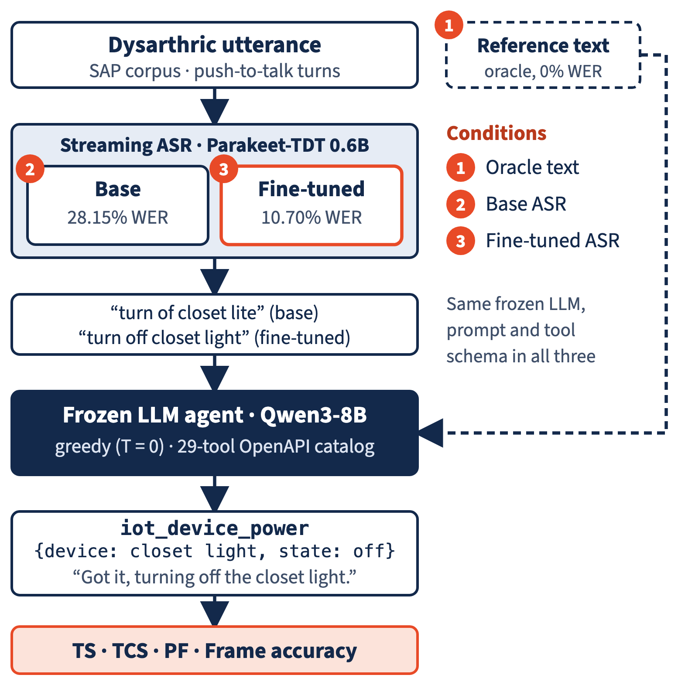

# Beyond WER: Quantifying ASR Error Propagation in Spoken Language Understanding for Dysarthric Speech

[-E84A27?style=for-the-badge)](benchmark_curation/)
[](schema_freeze/)

**Zixuan Yin (Presenter)¹**, **Xiuwen Zheng¹**, **Haolong Zheng¹**, **Kush Bhardwaj¹**, **Mark Hasegawa-Johnson¹**  
*¹University of Illinois Urbana-Champaign · Speech Accessibility Project (SAP), Statistical Speech Technology Lab (SSTL)*  
*Beckman Institute for Advanced Science and Technology & Thomas M. Siebel Center for Computer Science*

---

## 1. Overview & Core Research Question

Commercial voice assistants (Siri, Alexa, Google Assistant) are trained on normative speech, causing Word Error Rates (WER) to surge from **~3.2%** on typical speech to **36.3%** on dysarthric speech (motor speech disorders resulting from Parkinson's disease, ALS, Cerebral Palsy, or stroke).

However, **WER alone does not measure downstream task utility**:
* **Benign Acoustic Disfluencies:** Dysarthric vocal tremors, prolonged phonemes, and hesitation fillers (*"um"*, *"ah"*) inflate acoustic WER without impairing intent.
* **Catastrophic Entity Corruptions:** A single corrupted phoneme in a critical slot (*“call Kathy”* $\to$ *“call Cassie”*, *“turn on”* $\to$ *“turn off”*, *“5mg”* $\to$ *“50mg”*) incurs a minimal $+1$ token edit distance in WER, yet causes fatal tool execution failure or medication safety hazards.

> **Primary Research Question:** *What does fine-tuning a streaming ASR model on dysarthric speech buy us in an end-to-end downstream voice assistant, measured by task completion instead of transcription WER?*

---

## 2. Decoupled Pipeline Architecture

We evaluate a strictly decoupled cascaded system isolating acoustic transcription errors from LLM reasoning and slot extraction:

<p align="center">
  <a href="pipeline_architecture.png">
    
  </a>
</p>

### Controlled Experimental Conditions (Frozen LLM Agent)
1. **Condition 1 (Oracle Ceiling):** Human ground-truth transcripts fed directly to the LLM ($0.00\%$ WER). Measures semantic reasoning capacity under perfect transcription.
2. **Condition 2 (Base ASR):** Streaming zero-shot NVIDIA `Parakeet-TDT 0.6B` ($28.15\%$ WER on benchmark).
3. **Condition 3 (Fine-Tuned ASR):** Streaming `Parakeet-TDT 0.6B` acoustically adapted on speaker-disjoint SAP dysarthric speech ($10.70\%$ WER).

*All three conditions pass into the exact same frozen LLM agent (`Qwen3-8B`, greedy $T=0$) operating over a closed 29-tool OpenAPI catalog.*

---

## 3. Assistive SLU Catalog & SAP Corpus

* **Corpus Scale:** 124 speakers with dysarthria, 34,577 recordings, evaluated across $N = 1,108$ push-to-talk benchmark turns.
* **SLU Schema:** 10 functional assistive domains and 29 parameterized tools derived and filtered from Amazon MASSIVE:
  * **Accessibility:** `accessibility_dictation_toggle`, `accessibility_ui_scale`
  * **Calendar:** `alarm_manage`, `schedule_manage`
  * **Communication:** `call_make`, `call_manage`, `messages_manage`, `email_manage`
  * **General QA:** `qa_search`, `weather_query`, `device_find`, `order_manage`
  * **Health:** `health_medication_reminder`, `health_refill_query`, `health_info_query`
  * **Maps & Places:** `maps_route`, `places_search`, `reservations_manage`
  * **Media:** `media_play`, `media_search`, `media_control`, `media_volume`
  * **Notes & Memory:** `lists_manage`, `memory_note_manage`
  * **Smart Home:** `iot_device_power`, `iot_device_adjust`, `iot_sensor_query`
  * **Transport:** `rideshare_book`, `transit_lookup`

---

## 4. Benchmark Results ($N = 1,200$ Clean Balanced Audio Instances)

*Evaluated on NCSA Delta GPU cluster (NVIDIA A100-SXM4-80GB, 3,600 model evaluations) using `Qwen/Qwen3-8B` at greedy $T = 0$.*

### End-to-End Tool Calling & Spoken Affirmation Performance

| Evaluation Condition | Acoustic WER (%) | Tool Selection TS (%) | Struct Validity TCS (%) | Parameter Filling PF (%) | Command Frame Accuracy (%) | NLG Length ($\le 12$ Words) | Clean Speech Tokens (%) |
| :--- | :---: | :---: | :---: | :---: | :---: | :---: | :---: |
| **Condition 1: Oracle Ceiling** | 0.00% | **93.50%** (1,122/1,200) | **100.0%** (1,200/1,200) | **88.14%** (1,672/1,897) | **82.83%** (994/1,200) | **99.75%** | **100.0%** |
| **Condition 2: Base Parakeet ASR** | 28.15% | 71.58% (859/1,200) | 98.92% (1,187/1,200) | 51.40% (975/1,897) | **42.17%** (506/1,200) | 99.25% | 100.0% |
| **Condition 3: Fine-Tuned ASR** | **10.70%** | **90.25%** (1,083/1,200) | **99.92%** (1,199/1,200) | **78.39%** (1,487/1,897) | **69.67%** (836/1,200) | **99.92%** | **100.0%** |
| **Acoustic Adaptation Gain ($\Delta$)** | **-17.45%** | **+18.67%** | **+1.00%** | **+26.99%** | **+27.50%** | **+0.67%** | **0.00%** |

$$\text{Adaptation Recovery Rate (ARR)} = \frac{\text{Frame}_{\text{FT}} - \text{Frame}_{\text{Base}}}{\text{Frame}_{\text{Oracle}} - \text{Frame}_{\text{Base}}} = \frac{69.67\% - 42.17\%}{82.83\% - 42.17\%} = \frac{27.50\%}{40.66\%} = \mathbf{67.63\%}$$

### Clinical Etiology Breakdown (Command Frame Accuracy)

| Clinical Etiology | Audio Instances ($N$) | Condition 1 (Oracle) | Condition 2 (Base ASR) | Condition 3 (Fine-Tuned ASR) | Adaptation Gain ($\Delta_{\text{FT}-\text{Base}}$) |
| :--- | :---: | :---: | :---: | :---: | :---: |
| **Parkinson's Disease** | 240 | 81.67% | 62.50% | 77.08% | +14.58% |
| **ALS** | 240 | 85.00% | 43.75% | 73.75% | +30.00% |
| **Stroke** | 240 | 84.58% | 42.92% | 63.33% | +20.41% |
| **Cerebral Palsy** | 240 | 80.00% | 29.58% | 65.83% | **+36.25%** |
| **Down Syndrome** | 240 | 82.92% | 32.08% | 68.33% | **+36.25%** |

### Publication-Grade Semantic LLM-as-a-Judge Parameter Evaluation (`Qwen3.8-27B`)

Evaluates semantic recall and precision across all 1,897 gold slots and 2,133 predicted slots, distinguishing valid descriptive noun expansions (e.g. *"porch light"* for *"light"*) from unuttered hallucinations:

| Evaluation Metric | Exact Lexical Overlap (Char-F1 $\ge 0.85$) | Semantic LLM Judge (`Qwen3.8-27B`) | Semantic Net Gain ($\Delta$) |
| :--- | :---: | :---: | :---: |
| **Parameter Recall** | 86.14% (1,634 / 1,897) | **90.56%** (1,718 / 1,897) | **+4.42%** (+84 slots recovered) |
| **Parameter Precision** | 76.61% (1,634 / 2,133) | **84.72%** (1,807 / 2,133) | **+8.11%** (+173 slots validated) |
| **Parameter F1** | 81.09% | **87.54%** | **+6.45%** |

### Key Research Findings
1. **The Downstream Failure Bottleneck is in the Parameters:** Unadapted ASR causes end-to-end Command Frame Accuracy to drop from **82.83% down to 42.17%** (a $-40.66\%$ collapse). While high-level intent routing (Tool Selection) achieves $71.58\%$, Parameter Filling collapses by **$-36.74\%$** ($88.14\% \to 51.40\%$).
2. **Acoustic Adaptation Recovers Over Two-Thirds of Task Success:** Fine-tuning the streaming ASR restores **+27.50% absolute Command Frame Accuracy** ($42.17\% \to 69.67\%$, $+330$ net frames restored), translating to an **ARR of 67.63%**.
3. **Severe Etiologies Benefit Most:** For dysarthria with high acoustic disfluency (Cerebral Palsy and Down Syndrome), acoustic adaptation delivers a massive **+36.25% absolute command frame recovery**.
4. **Conversational Grounding Preserves Tool Integrity:** Spoken affirmations achieve **99.92% length compliance** ($\le 12$ words) and **100.0% clean speech tokens** without degrading tool-calling accuracy (paired McNemar test $p > 0.11$).

---

## 5. Repository Structure

```
sap-dialog-system/
├── schema_freeze/                           # Canonical SLU schema & annotation package
│   ├── canonical_tool_catalog.md           # Authoritative 29-tool schema definitions
│   ├── SLU_schema_v1.0.json                # Authoritative 29-tool, 10-domain JSON schema
│   └── SLU_annotator_guidelines.md         # Annotation protocol & span extraction rules
│
├── benchmark_curation/                      # Dataset sampling & MASSIVE intent mapping
├── audio/                                   # Audio turn samples and benchmark wav records
├── eval_results/                            # Cluster logs & evaluated prediction CSVs
│
├── evaluate_slu_nlg_qwen3.py                # Primary 3-condition SLU + Conversational Affirmation runner
├── evaluate_pf_llm_judge.py                 # Semantic LLM-as-a-judge for parameter slot filling
├── s2t_pipeline.py                          # Streaming Speech-to-Text inference pipeline
│
├── verify_no_leakage.py                     # Scientific leakage audit tool
├── verify_anti_hacking.py                   # Anti-prompt-hacking structural linter
│
├── run_nlg_1200.slurm                       # Primary SLURM batch job: 1,200 Clean Benchmark (SLU + NLG)
├── run_pf_llm_judge.slurm                   # SLURM batch job: Semantic LLM judge audit (Qwen3.8-27B)
│
├── clean_eval_1200_nlg_results.csv          # Evaluated predictions across all 3 conditions (1,200 instances)
├── clean_eval_1200_nlg_summary.json         # Complete metric summary JSON report
├── semantic_judge_1200_audit_decisions.csv  # Detailed row-by-row LLM judge audit trail (462 decisions)
├── semantic_judge_1200_summary.json         # Exact vs. semantic slot evaluation summary
│
├── archive/                                 # Archived legacy / intermediate evaluation harnesses
│   ├── evaluate_asr_llm_pipeline.py         # Modular evaluation harness (BaseASR + BaseLLM)
│   ├── evaluate_slu_enriched_qwen3.py       # Phase 2 SLU-only runner (pre-NLG)
│   ├── evaluate_slu_llm.py                  # Pilot 291 dev evaluator
│   ├── iterations/                          # Legacy iteration scripts (iter1 through iter12)
│   ├── slurm/                               # Legacy SLURM job scripts
│   ├── prompt_optimization/                 # Legacy heuristic prompt optimizers
│   └── intermediate_results/                # Intermediate iteration prediction CSVs and summaries
│
└── requirements.txt                         # Python package dependencies
```

---

## 6. Quick Start & Replication

### 1. Environment Setup

```bash
# Clone the repository
git clone https://github.com/zyin422/sap-dialog-system.git
cd sap-dialog-system

# Create environment and install dependencies
conda create -n sap-dialog python=3.10 -y
conda activate sap-dialog
pip install -r requirements.txt
```

### 2. Verify Scientific Orthogonality (Zero Test Leakage)

```bash
python verify_no_leakage.py certified_generalized_system_prompt_rev6_nlg.txt
python verify_anti_hacking.py
```

### 3. Run Benchmark Evaluations Locally

To run the primary 3-condition SLU + Spoken Affirmation (NLG) benchmark on a local GPU:

```bash
python evaluate_slu_nlg_qwen3.py \
    --csv_path sampled_benchmark_1200_clean.csv \
    --prompt_path certified_generalized_system_prompt_rev6_nlg.txt \
    --model_id Qwen/Qwen3-8B \
    --batch_size 12 \
    --condition all \
    --output_csv eval_results/clean_eval_1200_nlg_results.csv \
    --output_summary eval_results/clean_eval_1200_nlg_summary.json
```

To run the Semantic LLM-as-a-Judge slot audit on the predictions:

```bash
python evaluate_pf_llm_judge.py \
    --csv_path eval_results/clean_eval_1200_nlg_results.csv \
    --model_id Qwen/Qwen3.8-27B \
    --conditions oracle base_asr ft_asr \
    --output_json eval_results/semantic_judge_1200_summary.json \
    --audit_csv eval_results/semantic_judge_1200_audit_decisions.csv
```

### 4. Running Distributed Benchmarks on NCSA Delta GPU

```bash
# Launch primary 3-condition SLU + NLG evaluation across 1,200 benchmark clips
sbatch run_nlg_1200.slurm

# Run Qwen3.8-27B semantic LLM judge evaluation on parameter slots
sbatch run_pf_llm_judge.slurm
```

---

## Acknowledgments & Research Context

This research is conducted under the **Speech Accessibility Project (SAP)** at the **Beckman Institute for Advanced Science and Technology**, University of Illinois Urbana-Champaign, supported by the SAP Consortium (Google, Apple, Microsoft, Amazon, Meta, and the Davis Phinney Foundation).

High-performance computing resources and GPU nodes are provided by the **National Center for Supercomputing Applications (NCSA) Delta Cluster** under ACCESS allocations `bjas-delta-gpu` and `bedl-delta-gpu`.
