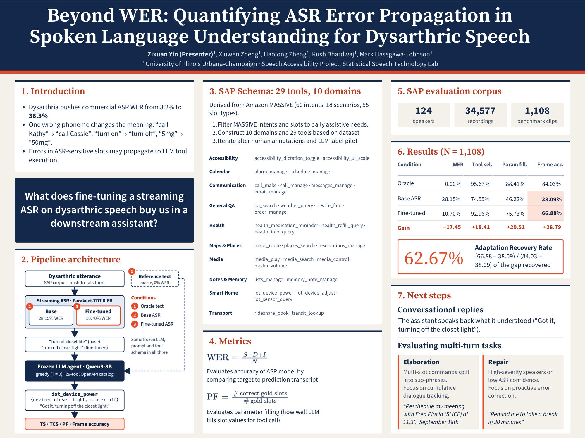

# Beyond WER: Quantifying ASR Error Propagation in Spoken Language Understanding for Dysarthric Speech

[-B93A1C?style=for-the-badge&logo=adobeacrobatreader&logoColor=white)](poster/Beyond_WER_Poster_48x36.pdf)
[](poster/poster.html)
[-E84A27?style=for-the-badge)](benchmark_curation/)
[](schema_freeze/)

**Zixuan Yin (Presenter)¹**, **Xiuwen Zheng¹**, **Haolong Zheng¹**, **Kush Bhardwaj¹**, **Mark Hasegawa-Johnson¹**  
*¹University of Illinois Urbana-Champaign · Speech Accessibility Project (SAP), Statistical Speech Technology Lab (SSTL)*  
*Beckman Institute for Advanced Science and Technology & Thomas M. Siebel Center for Computer Science*

---

## Research Poster (Trick or Research / CS STARS 2026)

<p align="center">
  <a href="poster/Beyond_WER_Poster_48x36.pdf">
    
  </a>
</p>

<p align="center">
  📄 <b><a href="poster/Beyond_WER_Poster_48x36.pdf">Download Poster PDF (Print-Ready 48" × 36")</a></b> &nbsp;•&nbsp; 
  🌐 <b><a href="poster/poster.html">Interactive Vector HTML</a></b> &nbsp;•&nbsp; 
  🖼️ <b><a href="poster/pipeline_architecture.png">Pipeline Architecture Diagram (PNG)</a></b>
</p>

---

## 1. Overview & Core Research Question

Commercial voice assistants (Siri, Alexa, Google Assistant) are trained on normative speech, causing Word Error Rates (WER) to surge from **~3.2%** on typical speech to **36.3%** on dysarthric speech (motor speech disorders resulting from Parkinson's disease, ALS, Cerebral Palsy, or stroke).

However, **WER alone does not measure downstream task utility**:
* **Benign Acoustic Disfluencies:** Dysarthric vocal tremors, prolonged phonemes, and hesitation fillers (*"um"*, *"ah"*) inflate acoustic WER without impairing intent.
* **Catastrophic Entity Corruptions:** A single corrupted phoneme in a critical slot (*“call Kathy”* $\to$ *“call Cassie”*, *“turn on”* $\to$ *“turn off”*, *“5mg”* $\to$ *“50mg”*) incurs a minimal $+1$ token edit distance in WER, yet causes fatal tool execution failure or medication safety hazards.

> **Primary Research Question:** *What does fine-tuning a streaming ASR model on dysarthric speech buy us in an end-to-end downstream voice assistant, measured by task completion instead of transcription WER?*

---

## 2. Decoupled Pipeline Architecture

We evaluate a strictly decoupled cascaded system isolating acoustic transcription errors from LLM reasoning and slot extraction:

<p align="center">
  <a href="poster/pipeline_architecture.png">
    
  </a>
</p>

### Controlled Experimental Conditions (Frozen LLM Agent)
1. **Condition 1 (Oracle Ceiling):** Human ground-truth transcripts fed directly to the LLM ($0.00\%$ WER). Measures semantic reasoning capacity under perfect transcription.
2. **Condition 2 (Base ASR):** Streaming zero-shot NVIDIA `Parakeet-TDT 0.6B` ($28.15\%$ WER on benchmark).
3. **Condition 3 (Fine-Tuned ASR):** Streaming `Parakeet-TDT 0.6B` acoustically adapted on speaker-disjoint SAP dysarthric speech ($10.70\%$ WER).

*All three conditions pass into the exact same frozen LLM agent (`Qwen3-8B`, greedy $T=0$) operating over a closed 29-tool OpenAPI catalog.*

---

## 3. Assistive SLU Catalog & SAP Corpus

* **Corpus Scale:** 124 speakers with dysarthria, 34,577 recordings, evaluated across $N = 1,108$ push-to-talk benchmark turns.
* **SLU Schema:** 10 functional assistive domains and 29 parameterized tools derived and filtered from Amazon MASSIVE:
  * **Accessibility:** `accessibility_dictation_toggle`, `accessibility_ui_scale`
  * **Calendar:** `alarm_manage`, `schedule_manage`
  * **Communication:** `call_make`, `call_manage`, `messages_manage`, `email_manage`
  * **General QA:** `qa_search`, `weather_query`, `device_find`, `order_manage`
  * **Health:** `health_medication_reminder`, `health_refill_query`, `health_info_query`
  * **Maps & Places:** `maps_route`, `places_search`, `reservations_manage`
  * **Media:** `media_play`, `media_search`, `media_control`, `media_volume`
  * **Notes & Memory:** `lists_manage`, `memory_note_manage`
  * **Smart Home:** `iot_device_power`, `iot_device_adjust`, `iot_sensor_query`
  * **Transport:** `rideshare_book`, `transit_lookup`

---

## 4. Benchmark Results ($N = 1,108$ Audio Instances)

*Evaluated on NCSA Delta GPU cluster (NVIDIA A100-SXM4-80GB, 3,324 model evaluations).*

| Evaluation Condition | Acoustic WER (%) | Tool Selection TS (%) | Struct Validity TCS (%) | Parameter Filling PF (%) | Command Frame Accuracy (%) |
| :--- | :---: | :---: | :---: | :---: | :---: |
| **Condition 1: Oracle Ceiling** | 0.00% | **95.67%** (1060/1108) | **100.0%** (1108/1108) | **88.41%** (1434/1622) | **84.03%** (931/1108) |
| **Condition 2: Base Parakeet ASR** | 28.15% | 74.55% (826/1108) | 99.28% (1100/1108) | 46.22% (750/1622) | **38.09%** (422/1108) |
| **Condition 3: Fine-Tuned ASR** | **10.70%** | **92.96%** (1030/1108) | **99.82%** (1106/1108) | **75.73%** (1228/1622) | **66.88%** (741/1108) |
| **Acoustic Adaptation Gain ($\Delta$)** | **-17.45%** | **+18.41%** | **+0.54%** | **+29.51%** | **+28.79%** |

$$\text{Adaptation Recovery Rate (ARR)} = \frac{\text{Frame}_{\text{FT}} - \text{Frame}_{\text{Base}}}{\text{Frame}_{\text{Oracle}} - \text{Frame}_{\text{Base}}} = \frac{66.88\% - 38.09\%}{84.03\% - 38.09\%} = \frac{28.79\%}{45.94\%} = \mathbf{62.67\%}$$

### Key Research Findings
1. **The Downstream Failure Bottleneck is in the Parameters:** Off-the-shelf ASR degrades end-to-end Command Frame Accuracy by **45.94%**. While high-level intent routing (Tool Selection) remains relatively resilient ($74.55\%$), Parameter Filling collapses from **88.41% down to 46.22%** (a $-42.19\%$ collapse).
2. **Acoustic Adaptation Recovers Six-Tenths of Task Success:** Fine-tuning the streaming ASR recovers **+28.79% absolute Command Frame Accuracy** ($38.09\% \to 66.88\%$), translating to an **ARR of 62.67%**.

---

## 5. Repository Structure

```
sap-dialog-system/
├── poster/                                  # Research poster & presentation deliverables
│   ├── Beyond_WER_Poster_48x36.pdf         # Print-ready 48" × 36" poster PDF
│   ├── poster_preview.png                  # High-resolution (2000px) poster preview image
│   ├── poster.html                         # Zero-dependency interactive HTML poster
│   ├── pipeline_architecture.png           # 1554×1571 standalone high-res architecture diagram
│   ├── pipeline_architecture.svg           # Scalable vector source for architecture diagram
│   ├── wer.svg / pf.svg                    # Vector LaTeX metric formulas
│   └── poster.md                           # Architectural design specification & copy
│
├── schema_freeze/                           # Canonical SLU schema & annotation package
│   ├── canonical_tool_catalog.md           # Authoritative 29-tool schema definitions
│   ├── SLU_annotator_guidelines.md         # Annotation protocol & span extraction rules
│   └── pilot/                              # Dual-annotator webapp & adjudication records
│
├── benchmark_curation/                      # Dataset sampling & MASSIVE intent mapping
│   └── Amazon_MASSIVE_evaluation.md        # Filtering methodology for assistive voice tasks
│
├── audio/                                   # Audio turn samples and benchmark wav records
├── eval_results/                            # SLURM execution logs & evaluated predictions
│
├── evaluate_asr_llm_pipeline.py             # Modular evaluation harness (BaseASR + BaseLLM)
├── evaluate_slu_enriched_qwen3.py           # 3-condition benchmark runner on Delta cluster
├── evaluate_slu_nlg_qwen3.py                # SLU + NLG conversational affirmation runner
├── evaluate_pf_llm_judge.py                 # Qwen3.8-27B semantic LLM-as-a-judge for slot filling
├── s2t_pipeline.py                          # Streaming Speech-to-Text inference pipeline
│
├── verify_no_leakage.py                     # Scientific leakage verification test
├── verify_anti_hacking.py                   # Anti-prompt-hacking compliance checker
│
├── run_clean_1200.slurm                     # SLURM script: 1,200 clean benchmark evaluation
├── run_pf_llm_judge.slurm                   # SLURM script: Semantic LLM judge audit
└── requirements.txt                         # Python package dependencies
```

---

## 6. Quick Start & Replication

### 1. Environment Setup

```bash
# Clone the repository
git clone https://github.com/zyin422/sap-dialog-system.git
cd sap-dialog-system

# Create environment and install dependencies
conda create -n sap-dialog python=3.10 -y
conda activate sap-dialog
pip install -r requirements.txt
```

### 2. Run Local Evaluation

To run intent and slot extraction on sample audio transcripts:

```bash
python s2t_pipeline.py
```

### 3. Verify Scientific Orthogonality (Zero Test Leakage)

Before running or updating any prompts or schemas, verify that evaluation entities have not contaminated prompts:

```bash
python verify_no_leakage.py
python verify_anti_hacking.py
```

### 4. Running Distributed Benchmarks on NCSA Delta GPU

```bash
# Launch 3-condition evaluation across 1,200 benchmark clips
sbatch run_clean_1200.slurm

# Run Qwen3.8-27B semantic judge evaluation on slot filling
sbatch run_pf_llm_judge.slurm
```

---

## Acknowledgments & Research Context

This research is conducted under the **Speech Accessibility Project (SAP)** at the **Beckman Institute for Advanced Science and Technology**, University of Illinois Urbana-Champaign, supported by the SAP Consortium (Google, Apple, Microsoft, Amazon, Meta, and the Davis Phinney Foundation).

High-performance computing resources and GPU nodes are provided by the **National Center for Supercomputing Applications (NCSA) Delta Cluster** under ACCESS allocations `bjas-delta-gpu` and `bedl-delta-gpu`.
