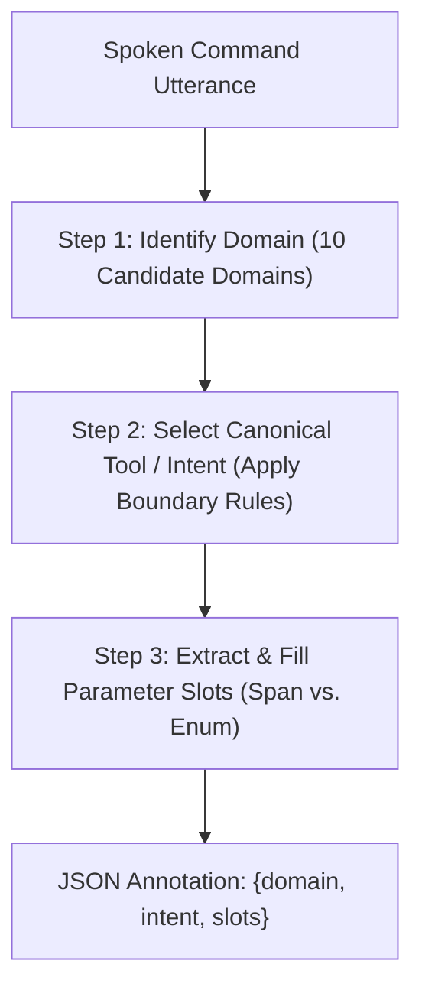

# Speech Accessibility Project (SAP) — Spoken Language Understanding (SLU)
## Annotator Guidelines (Pilot Round — Step 3)

**Document Version:** 1.1  
**Target Dataset:** `SLU_pilot_50.csv` (50 Stratified Spoken Commands)  
**Task:** Independent annotation of Domain, Tool (Intent), and Slot (Parameter) arguments for spoken assistant utterances from dysarthric speakers.

---

## Master Ontology Map: Domains, Intents, and Associated Slots

Before labeling, use this master index to review the complete 3-tier hierarchy across all **10 Functional Domains**, **28 Canonical Tools (Intents)**, and their typed parameter slots:

| Domain | Canonical Tool (Intent) | Associated Slots (Type) | Core Functional Scope |
| :--- | :--- | :--- | :--- |
| **`accessibility`** | `accessibility_dictation_toggle` | `state` *(Enum)* | Start/stop continuous voice dictation listening. |
| | `accessibility_ui_scale` | `direction` *(Enum)*, `ui_element` *(Enum)* | Adjust on-screen text size or screen magnification. |
| **`calendar_alarm`** | `alarm_manage` | `action` *(Enum)*, `time` *(Span)*, `date` *(Span)*, `general_frequency` *(Enum)* | Set, cancel, snooze, or query alarms and countdown timers. |
| | `schedule_manage` | `action` *(Enum)*, `title` *(Span)*, `date` *(Span)*, `time` *(Span)*, `person` *(Span)* | Create, update, cancel, or query calendar events, appointments, and task reminders. |
| **`communication`** | `call_make` | `recipient_name` *(Span)*, `phone_number` *(Span)* | Initiate outgoing voice/video telephone calls. |
| | `call_manage` | `action` *(Enum)* | In-call controls (answer, decline, hang up, mute, redial). |
| | `messages_manage` | `action` *(Enum)*, `recipient` *(Span)*, `message_body` *(Span)* | Send, read, or reply to SMS text messages. |
| | `email_manage` | `action` *(Enum)*, `recipient` *(Span)*, `date` *(Span)*, `message_body` *(Span)* | Compose, send, search, or read electronic mail. |
| **`general_qa`** | `qa_search` | `query` *(Span)* | Factual knowledge, encyclopedia, recipes, news, stocks, math. |
| | `weather_query` | `place_name` *(Span)*, `date` *(Span)*, `weather_aspect` *(Span)* | Meteorological weather forecasts, rain/snow, temperatures. |
| | `device_find` | `device_type` *(Span)* | Audible ping to locate a misplaced hardware device. |
| | `order_manage` | `action` *(Enum)* | E-commerce package tracking, returns, and order cancellations. |
| **`health`** | `health_medication_reminder` | `medication` *(Span)*, `time` *(Span)* | Schedule clinical prescription or supplement dosage reminders. |
| | `health_refill_query` | `medication` *(Span)* | Inquire about remaining pharmacy prescription refills. |
| | `health_info_query` | `medication` *(Span)*, `info_type` *(Enum)* | Inquire about drug side effects, dosage, or interactions. |
| **`maps_places`** | `maps_route` | `destination` *(Span)*, `query_type` *(Enum)* | Driving directions, navigation, distance, or commute traffic. |
| | `places_search` | `business_name` *(Span)*, `business_type` *(Span)*, `sort_by` *(Enum)* | Search nearby stores, venues, restaurants, and opening hours. |
| | `reservations_manage` | `business_name` *(Span)*, `time` *(Span)*, `party_size` *(Span)*, `date` *(Span)* | Book or inspect dining table reservations at venues. |
| **`media`** | `media_play` | `media_type` *(Enum)*, `title` *(Span)*, `artist` *(Span)*, `house_place` *(Span)* | Stream music tracks, albums, podcasts, radio, or audiobooks. |
| | `media_control` | `action` *(Enum)*, `duration` *(Span)* | Playback state (pause, resume, skip, scrub forward/back, like). |
| | `media_volume` | `action` *(Enum)*, `change_amount` *(Span)* | Adjust, mute, unmute, or set audio playback volume level. |
| **`notes_memory`** | `lists_manage` | `action` *(Enum)*, `item` *(Span)*, `list_name` *(Span)* | Create, add items to, or query shopping and to-do lists. |
| | `memory_note_manage` | `action` *(Enum)*, `key` *(Span)*, `value` *(Span)* | Store or recall personal facts and notes lacking time anchors. |
| **`smart_home`** | `iot_device_power` | `device_type` *(Span)*, `state` *(Enum)*, `house_place` *(Span)* | Binary power toggle (appliances, lights) & door lock state. |
| | `iot_device_adjust` | `device_type` *(Span)*, `setting` *(Enum)*, `direction` *(Enum)*, `value` *(Span)* | Continuous adjustments (thermostat, brightness, color, speed). |
| | `iot_sensor_query` | `sensor_type` *(Enum)*, `room` *(Span)* | Inquire about ambient indoor room sensors (e.g. temperature). |
| **`transport`** | `rideshare_book` | `destination` *(Span)* | Hail or book a taxi, cab, or rideshare vehicle. |
| | `transit_lookup` | `transit_type` *(Enum)*, `destination` *(Span)*, `route_or_station` *(Span)*, `time` *(Span)* | Public transit schedules and tickets (trains, buses, flights). |

---

## 1. Annotation Protocol & The 3-Step Decision Flow

For each command in the pilot set, follow this sequential 3-step decision flow:

### Step 1: Identify the Functional Domain
Select 1 of the 10 functional domains defined in the Master Ontology Map above based on the primary system capability the user is invoking.

---

### Step 2: Select the Canonical Tool (Intent)
Match the command against the tools defined in the Master Ontology Map and [`canonical_tool_catalog.md`](file:///Users/zixuan/agy2-projects/sap-dialog-system/schema_freeze/canonical_tool_catalog.md). Apply these core boundary rules:
* **`alarm_manage` vs. `schedule_manage`:** `alarm_manage` requires explicit words (`"alarm"`, `"timer"`) or relative countdown offsets (*"in 15 minutes"*). `schedule_manage` handles calendar events, appointments, and task reminders.
* **`media_play` vs. `media_control`:** `media_play` starts playback of media content. `media_control` changes state during playback (pause, resume, skip, fast-forward, rewind, like, dislike).
* **`iot_device_power` vs. `iot_device_adjust`:** Binary power toggles (`{"on", "off"}`) are `iot_device_power` (including door locks: lock $\rightarrow$ `"on"`, unlock $\rightarrow$ `"off"`). Continuous adjustments (brightness, temperature, color, speed) are `iot_device_adjust`.
* **`memory_note_manage` vs. `schedule_manage`:** If an utterance specifies a **specific trigger time or date** (*"Remind me at 3 PM to call Bob"*), route to `schedule_manage`. If it lacks a time anchor (*"Remember my locker code is 4412"*), route to `memory_note_manage`.
* **`qa_search` Boundary:** Restrict to factual questions, definitions, calculations, and general queries. Do NOT route local business searches (`places_search`) or route directions (`maps_route`) to `qa_search`.

---

### Step 3: Extract Slots (The Dual-Type Slot Rule)
Every parameter belongs strictly to one of two mutually exclusive types:

#### Type A: Extractive Spans (Verbatim Substrings)
* **Verbatim Substring:** Exact literal substring from the transcript in lowercase.
* **Bare Nominal (BaseNP):** Exclude governing prepositions (`at`, `to`, `in`, `for`, `with`, `on`) and articles (`a`, `an`, `the`). E.g., *"Drive to Chicago"* $\rightarrow$ `destination: "chicago"`.
* **Strict No-Hallucination:** Only extract entities explicitly uttered. Never invent unuttered keys or default values (e.g., in *"Where did I park?"*, leave slots as `{"action": "recall"}`; do NOT invent `key: "parking_space"`).
* **Dysarthric Speech Handling:** Strip repeated stutter words (e.g., *"the the living room"* $\rightarrow$ `"living room"`). Preserve literal phonetic transcriptions without spelling corrections (e.g., *"recipe with cliantro"* $\rightarrow$ `query: "recipe with cliantro"`).

#### Type B: Categorical Enums (Predefined Menus)
* **Closed Set:** Select strictly from the allowed string literals in [`canonical_tool_catalog.md`](file:///Users/zixuan/agy2-projects/sap-dialog-system/schema_freeze/canonical_tool_catalog.md). Never invent new enum strings.
* **Normalize Synonyms:** Normalize spoken synonyms to the canonical enum literal (e.g., *"crank up volume"* $\rightarrow$ `action: "up"`; *"kill the lamp"* $\rightarrow$ `state: "off"`).

#### Zero-Argument Invariance:
* If a command has no parameters, `slots` MUST be an empty object `{}`.

#### Outside (O) Wake Words:
* Wake words (`"Alexa"`, `"Hey Siri"`, `"Hey Google"`) are Outside tokens. Never extract wake words into any slot!

---

## 2. Master Parameter & Tool Catalog Reference

For complete parameter specifications (categorical enums, extractive span BaseNP rules) and the itemized 28-tool catalog with inclusion/exclusion exemplars, refer to the standalone reference:

* **Authoritative Catalog & Parameter Reference:** [`canonical_tool_catalog.md`](file:///Users/zixuan/agy2-projects/sap-dialog-system/schema_freeze/canonical_tool_catalog.md)

---

## 3. Dual-Annotator Protocol & Handoff Checklist

1. **Independent Annotation:** Annotator 1 and Annotator 2 independently label the 50 pilot commands in [`SLU_pilot_50.csv`](file:///Users/zixuan/agy2-projects/sap-dialog-system/schema_freeze/pilot/SLU_pilot_50.csv) (or via the interactive webapp [`slu_annotator.html`](file:///Users/zixuan/agy2-projects/sap-dialog-system/schema_freeze/pilot/slu_annotator.html)).
2. **Output Formatting:** Each annotator produces a completed CSV file with columns: `id`, `prompt`, `domain`, `intent`, `slots_json`, `notes`.
3. **Agreement Computation:** Inter-annotator agreement (Cohen's $\kappa$ for domain and intent; slot F1) is computed on the initial blind labels.
4. **Adjudication Session:** Flagged discrepancies are discussed jointly in a 30-minute adjudication review to establish the ground-truth Gold standard ($y^*$) for Step 4.
